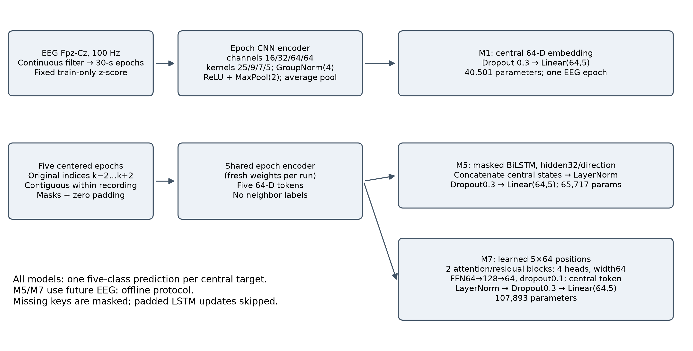
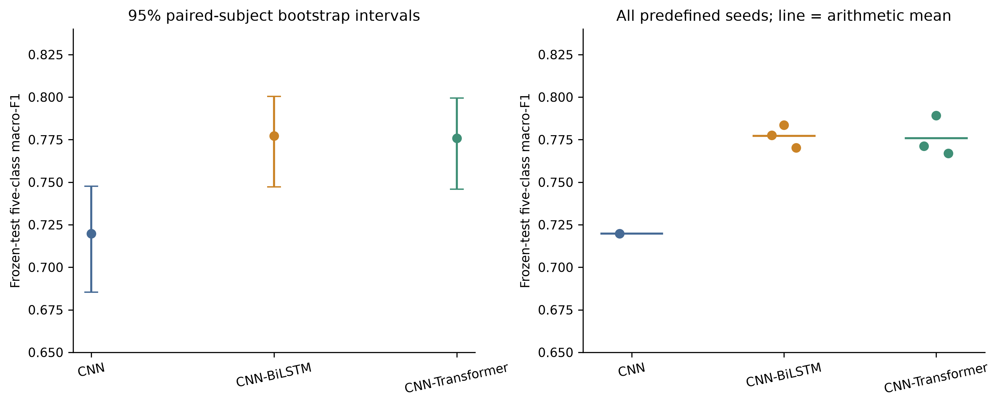
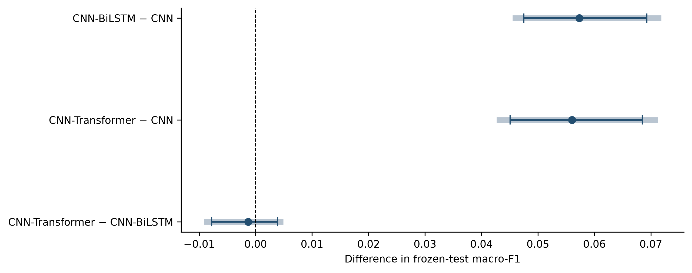
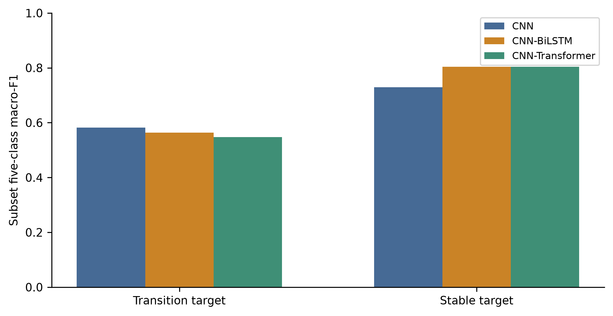
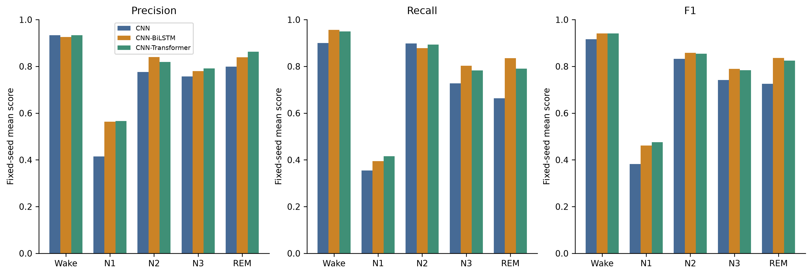
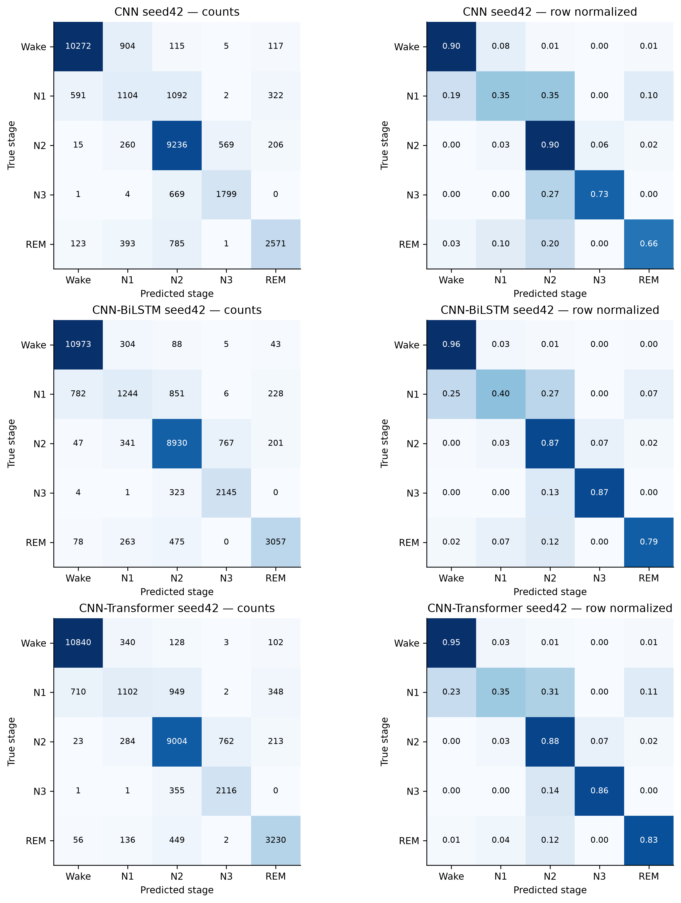

> Curated public-export copy. Historical originals remain unchanged. Links to excluded evidence point to the artifact-availability guide; this is not the complete private publication archive.

# Compact Single-Epoch and Contextual EEG Models for Sleep Staging: A Subject-Independent Comparison with Class and Transition Tradeoffs

Author names, affiliations and corresponding-author details: to be supplied by the authors. This separate revision preserves the measured results of the original manuscript (additional evidence). [Availability and reproduction inputs](../docs/ARTIFACT_AVAILABILITY.md).

## Abstract

**Background:** Single-channel EEG sleep staging requires evaluation that exposes class-specific errors and differences in the information available to competing models. **Methods:** We compared a single-epoch CNN (M1) with compact CNN–BiLSTM (M5) and CNN–Transformer (M7) models using Sleep-EDF Expanded Sleep Cassette data from 78 subjects. A frozen subject-independent allocation contained 54 training, 12 validation and 12 test subjects. All models used Fpz-Cz EEG, the same preprocessing and label-informed Wake eligibility, and identical final targets. M1 processed one 30-s epoch and had 40,501 parameters; M5/M7 processed five-epoch context windows and had 65,717/107,893 parameters. M1 had one training seed; M5/M7 each had three predefined seeds. Final evaluation covered 31,156 epochs, with paired subject-bootstrap uncertainty. **Results:** Macro-F1 was 0.7198 for M1, 0.7771 ± 0.0066 for M5 and 0.7758 ± 0.0118 for M7; ± denotes training-seed sample SD. However, on 3,498 retrospectively defined transition targets, macro-F1 was 0.5821, 0.5636 and 0.5479, respectively. M7 minus M5 aggregate macro-F1 was -0.0013 (95% paired-subject interval [-0.0078, 0.0039]). **Conclusions:** Contextual configurations improved aggregate classification in this holdout while scoring lower on the transition subset. Differences in input context, model capacity and seed replication prevent attribution of the aggregate gains exclusively to recurrence or attention. This offline, single-cohort comparison supports transparent reporting of such tradeoffs, rather than architectural superiority or clinical generalization.

**Keywords:** sleep staging; Sleep-EDF Expanded; single-channel EEG; temporal context; subject-independent evaluation; N1; reproducibility.

## 1. Introduction

Automatic sleep staging assigns successive EEG intervals to Wake, non-REM stages and REM. For single-channel systems, a useful comparison must specify both the prediction target and the information supplied to the model. Classifying an isolated epoch differs from classifying its central stage with surrounding EEG. Shared labels and preprocessing alone therefore do not establish a comparison that isolates architecture.

Sleep-EDF Expanded provides an accessible basis for studying this problem [R1,R2]. We cite its dataset record, the original PhysioNet resource paper and the platform's later description separately [R1,R14,R3]. Neighboring epochs and repeated nights belong to the same participant; allocating them across development and evaluation sets would undermine an assessment of generalization to unseen subjects. We preserve subject grouping and retain the original epoch identities throughout the analysis.

### 1.1. Related work

**Single-channel representation and temporal context.** DeepSleepNet combines raw single-channel convolutional feature extraction with bidirectional recurrent modeling [R4]. SeqSleepNet instead formulates hierarchical sequence-to-sequence staging, separating within-epoch processing from longer sequence modeling [R5]. IITNet explicitly studies intra- and inter-epoch information and varies input sequence length [R15]. Together, these studies make temporal context an experimental factor that deserves explicit reporting, rather than an interchangeable detail of a classifier. Our centered-window central-target prediction differs from producing labels for an entire sequence, and the present models are compact implementations of established families, not reproductions of these published systems.

AttnSleep combines multiresolution convolution, feature recalibration and attention over extracted features [R6]. SleepTransformer uses Transformer sequence modeling and examines interpretation and uncertainty [R7]. The location of attention, the input representation and the extent of accessible context differ across these designs. Accordingly, recurrence or attention by itself is not a sufficiently specific basis for comparing published scores. Our experiment does not establish which mechanism would be preferable at matched capacity and matched input context.

**Minority classes and evaluation objectives.** N1 recognition deserves separate assessment because an aggregate score can conceal a weak minority-class result. AttnSleep includes a class-aware cost-sensitive objective, providing a sleep-specific precedent for evaluating imbalance treatments [R6]. Human scorer-reliability research also reports difficulty with N1 and some stage boundaries [R11]. That finding motivates class- and transition-specific reporting; it does not show that our errors arise from scorer disagreement. Sleep-EDF's historical labels and merged deep-sleep stages do not recreate modern AASM multi-scorer consensus. We therefore assess training-only weighted cross-entropy as a secondary comparison and retain precision and recall alongside F1, without assuming that weighting must improve every objective.

**Subject independence, transfer and efficiency.** U-Sleep's evaluation across heterogeneous studies illustrates a broader generalization question than a holdout from one cohort [R10]. Our subject-disjoint split addresses within-cohort subject generalization, not transfer across acquisition systems, clinical populations or scoring practices. TinySleepNet and DeepSleepNet-Lite demonstrate that compact raw-EEG modeling and reduced contextual complexity are established research goals [R8,R9]. DeepSleepNet-Lite also studies uncertainty, emphasizing that a confidence-aware workflow is a separate question from model size. Here we report parameter counts, partial operation counts and observed wall times with their measurement limits. These studies are methodological context, not a protocol-matched numerical leaderboard: cohort selection, channels, Wake treatment, labels, input duration and evaluation designs differ.

### 1.2. Study objectives and contributions

The study asks whether two compact contextual configurations improve classification relative to a preserved epoch-level CNN under one unchanged offline protocol, and whether aggregate gains extend to N1 and transition targets. Its contributions are a comparison with explicit input/capacity/seed disclosures; evaluation on identical original targets with subject-aware uncertainty; and an auditable record of class, transition and computational tradeoffs. Checkpoint selection and the final roster preceded test inference. All predefined seeds are retained. We make no new-architecture, state-of-the-art or human-level claim, and this focused literature review does not establish an exhaustive novelty gap.

## 2. Materials and methods

### 2.1. Cohort, annotations and frozen allocation

The Sleep Cassette (SC) inventory contained 153 paired recordings from 78 subjects. Sleep Telemetry (ST), 44 recordings from 22 subjects, was inventoried separately and used for neither development nor final model evaluation. Fpz-Cz and Pz-Oz availability was recorded; only Fpz-Cz was used. The source labels were mapped to Wake=0, N1=1, N2=2, N3=3 and REM=4, merging original stages 3 and 4. This harmonization is not a rescoring of the recordings.

Epochs are half-open intervals $30k,30(k+1))$ s from PSG start, requiring exact sample boundaries, a verified common annotation/signal origin and unique complete coverage. Movement and unknown annotations were excluded from supervised labels: 128 and 1,335 SC epochs, respectively. The SC audit found 0 missing complete epochs, 0 overlapping epochs and 0 invalid-timing epochs. These counts are separate from annotation overhang: a documented annotation extended beyond its signal, and only signal-supported epochs were retained. No timestamps were shifted and no beyond-signal samples or labels were manufactured. The detailed inventory and exceptions remain in [Phase 1 (additional evidence). [Availability and reproduction inputs](../docs/ARTIFACT_AVAILABILITY.md).

Subject seed 42 fixed the allocation in Table 1 before model development. All nights of each study-qualified subject remain in the same split. Protocol A is the sole modeling protocol; Protocol B is an eligibility description, not a second evaluated model dataset.

**Table 1. Frozen SC allocation and eligible central epochs.**

| Split | Subjects | Recordings | Protocol A epochs | Protocol B epochs |
| --- | --- | --- | --- | --- |
| Train | 54 | 107 | 134,047 | 289,952 |
| Validation | 12 | 24 | 30,266 | 65,338 |
| Test | 12 | 22 | 31,156 | 59,671 |

Counts are epochs, not independent participants. A: primary Wake-trimmed eligibility; B: all valid supervised epochs. The split evidence (additional evidence). [Availability and reproduction inputs](../docs/ARTIFACT_AVAILABILITY.md) and [full-precision allocation table](../results/publication_tables/01_dataset_split.csv) are preserved.

### 2.2. Signal preprocessing and eligibility

Native Fpz-Cz sampling was 100 Hz; each 30-s epoch contains 3,000 samples. Calibrated EEG in µV was filtered continuously before epoch extraction using `butter(4, [0.3, 35], fs=100, btype="bandpass", output="sos")` and `sosfiltfilt`. Filtering used float64 and odd padding of 27 samples; stored epochs are unnormalized float32. The fourth-order prototype yields an eighth-order one-pass band-pass filter; the two-pass amplitude response is squared, with approximately −6.02 dB at the specified cutoffs. Acquisition-filter limitations and boundary effects remain. Saved coefficients and response details are retained in Supplement S1.

Protocol A retains up to 60 original epochs (30 min) before the first and after the last valid sleep epoch, including all eligible internal Wake. Gaps retain their original indices. Compared with B's 414,961 epochs, A retains 195,469 and removes 219,492 exterior Wake epochs; Wake prevalence changes from 68.79% to 33.73%. No non-Wake class count changes. This is label-informed offline eligibility, not an autonomous sleep-boundary detector.

One global population mean and standard deviation were fitted exclusively on Protocol A training samples: displayed values 0.00002422 µV and 17.664352 µV, respectively, with `ddof=0`. Validation and test loading use the unchanged full-precision saved values:

$$x'_{k,n}=\frac{x_{k,n}-\mu_{\mathrm{train}}}{\sigma_{\mathrm{train}}}.$$

Nonfinite raw or filtered recordings and exact constant raw epochs were subject to rejection under the saved protocol. ADC rail contacts and recording-edge proximity were retained as flags, without new amplitude exclusions. All 328 flagged final-test epochs remain included. These numerical flags are not expert artifact diagnoses. Noncausal filtering and label-informed eligibility already constrain deployment interpretation, including for M1.

### 2.3. Models, context boundaries and comparison fairness

**Table 2. Information, capacity and replication in the primary comparison.**

| Configuration | Input per central prediction | Nominal EEG duration | Trainable parameters | Completed training seeds |
| --- | --- | --- | ---: | --- |
| M1: CNN | One central epoch | 30 s | 40,501 | 42 only |
| M5: CNN–BiLSTM | Five centered epoch slots | Up to 150 s | 65,717 | 42, 43, 44 |
| M7: CNN–Transformer | Five centered epoch slots | Up to 150 s | 107,893 | 42, 43, 44 |

All configurations share central targets, Fpz-Cz preprocessing, training-only normalization, class mapping and subject allocation. **The comparison is controlled for these factors but does not match input context, model capacity or seed replication.** The observed M5/M7 gains over M1 cannot be assigned exclusively to recurrent or attention mechanisms. The nominal window is shortened by masks at boundaries or gaps; it is not five valid epochs for every target. Equal maximum training budgets also do not imply identical realized stopping times.

#### Shared epoch encoder and CNN baseline

The encoder has four bias-free Conv1d blocks with channel widths `(16,32,64,64)`, kernels `(25,9,7,5)` and strides `(2,2,2,1)`, using half-kernel padding. Each block applies GroupNorm with four groups, ReLU and MaxPool1d of width two. Adaptive temporal average pooling produces a 64-dimensional epoch feature `z_k=E(x'_k)`. The baseline M1 applies dropout 0.3 and a linear `64→5` classifier. M1 contains 40,501 trainable parameters. M4 has the identical architecture but uses weighted training loss.

The encoder in the context models has the same convolution/pooling construction with its classifier removed. Each run starts from fresh seeded weights; contextual runs do not fine-tune the trained M1 checkpoint. GroupNorm does not accumulate running batch statistics. Its temporal normalization and global pooling mean that local convolutional receptive-field calculations alone do not describe the entire epoch's effective support.

#### Boundary-safe context

For original index `k`, the contextual input contains valid neighbors from `k−2` through `k+2`. A neighbor must share subject, recording, night and split; all intervening original indices must be eligible and contiguous. Lookup stops at the first gap in either direction. Missing neighbors are zero-filled after normalization and accompanied by an explicit binary mask `m_t`. The central epoch is always present. Masks and original context IDs are preserved with the predictions. Neither neighbor annotations nor predicted stage sequences are inputs.

The packed implementation tensor has five slots, each containing 3,000 EEG samples and a separate final mask scalar. This scalar is unpacked before convolution and is not an additional EEG sample. The nominal contextual window covers five epochs, including up to 60 seconds of future EEG after the central epoch; gaps may shorten available context. No recurrent state persists across windows or recordings.

#### CNN–BiLSTM, M5

Separate forward and backward LSTM cells have hidden width 32 per direction. For the relevant traversal, candidate states follow the standard gated recurrence:

$$[i_t,f_t,o_t,g_t]=\sigma,\sigma,\sigma,\tanh (additional evidence). [Availability and reproduction inputs](../docs/ARTIFACT_AVAILABILITY.md),$$
$$\widetilde c_t=f_t\odot c_{t-1}+i_t\odot g_t,\qquad \widetilde h_t=o_t\odot\tanh(\widetilde c_t).$$

Masking retains the previous hidden and cell states whenever the current slot is missing. The forward and backward hidden states at the central position are concatenated, normalized by LayerNorm and passed through dropout 0.3 and a linear five-class head. M5 contains 65,717 parameters.

#### CNN–Transformer, M7

Five learned 64-dimensional position vectors are added to the masked EEG tokens. Two context blocks each use four-head self-attention with head width 16, residual connections and LayerNorm, followed by a `64→128→64` feed-forward network with GELU and dropout 0.1. Attention-weight dropout is also 0.1. With missing keys assigned negative-infinite attention logits,

$$A=\operatorname{softmax}(QK^\top/\sqrt{16}+M),\qquad \operatorname{Attn}(Q,K,V)=AV.$$

Each block uses post-residual normalization; padded token outputs are zeroed after the block. Only the central output is classified after final LayerNorm, dropout 0.3 and the `64→5` head. M7 contains 107,893 parameters. This is a compact raw-EEG contextual implementation, not a reproduction of SleepTransformer [R7].

*Figure 1.* Compact research implementations, not reproductions of the cited networks. M1 accesses one EEG epoch; M5/M7 access up to five centered epochs and have different parameter counts. All predict the same central label. The shared encoder denotes a common design within each independently initialized run, not shared fitted weights across runs. See Table 2 for seed replication and context duration. [PDF export](../results/publication_figures/01_architectures.pdf).

### 2.4. Training, validation selection and final checkpoint registration

Primary models used ordinary cross-entropy and AdamW [R12], learning rate 0.001, weight decay 0.01, betas (0.9, 0.999), epsilon $10^{-8}$, batch size 16 and float32 MPS. Maximum training was 25 epochs, with patience eight and no scheduler. The strictly highest complete-validation five-class macro-F1 selected each checkpoint. The initial advanced campaign ranked eight architecture/loss configurations at seed 42 and repeated the two shortlisted ordinary-CE configurations, M5 and M7, at seeds 43 and 44. M1 seed 42 was preserved. Validation means were 0.6938, 0.7423 and 0.7454, respectively. They are development/selection results, not final-test estimates.

The final plan fixed 9 checkpoints before test inference: the seven primary checkpoints in Table 2, plus secondary weighted-CE M1 (M4) and weighted-CE M5, each at seed 42. No ensemble, test-selected seed or test-fitted threshold was used. The sealed evaluation plan (additional evidence). [Availability and reproduction inputs](../docs/ARTIFACT_AVAILABILITY.md) and checkpoint identities (additional evidence). [Availability and reproduction inputs](../docs/ARTIFACT_AVAILABILITY.md) bind source, software, data and model fingerprints. M8 was excluded from the final-test roster. Exploratory validation ablations are assigned to Supplement S4.

For weighted references, $w_c=N_{\mathrm{train}}/(5n_c)$ used only training counts, ordered Wake, N1, N2, N3, REM: (43,782, 15,249, 47,664, 9,302, 18,050). The minibatch objective was

$$L_{\mathrm{WCE}}=\frac{\sum_j w_{y_j}[-\log p_{j,y_j}]}{\sum_j w_{y_j}}.$$

Ordinary validation CE was retained separately from weighted objective loss. The earlier optimizer/focal-loss pilots were development evidence, not additional final comparators; Adam's coupled L2 and AdamW's decoupled decay do not provide identical regularization at the same numeric decay setting [R12].

### 2.5. Outcomes and uncertainty

The primary outcome is five-class macro-F1. For class $c$,

$$F_{1,c}=\frac{2TP_c}{2TP_c+FP_c+FN_c},\qquad F_{1,\mathrm{macro}}=\frac{1}{5}\sum_{c=0}^{4}F_{1,c}.$$

Accuracy, balanced accuracy, Cohen's $\kappa$, and all class precision/recall/F1 scores accompany it. Undefined class precision/recall/F1 is zero, and all five classes remain in macro-F1; balanced accuracy averages recall over classes present in ground truth. Undefined specificity, $\kappa$, ROC AUC or average precision is null. Additional metric definitions, calibration and support tables are in Supplement S2. Model-level estimates average per-seed metrics over all fixed seeds, not probabilities; M1's seed SD is undefined rather than zero.

The registered paired cluster bootstrap used 10000 draws, RNG seed 20261016. Each draw resampled the 12 test subjects with replacement, retaining all of each selected subject's epochs and nights with multiplicity. Identical subject draws were used across models and seeds. Metrics were calculated from pooled subject-weighted confusion counts within each seed and then averaged across the fixed seeds. The primary statistic is not an equal-weight mean of subject F1 values. We report 95% percentile intervals and approximate Bonferroni 98.333% marginal intervals for the three predefined primary macro-F1 comparisons. Other class/subset analyses are descriptive. Training-seed sample SD (`ddof=1`) and subject-bootstrap uncertainty answer different questions and are reported separately. The bootstrap conditions on these fitted models and this split; it does not estimate joint uncertainty over new training seeds or cohorts. Only 12 independent test subjects limit interval reliability.

A transition target has a true stage different from that of the immediately preceding consecutive original epoch within the same subject, recording and night. Stable targets have the same true stage. Starts and targets after gaps enter neither subset. Previous true labels are used only for retrospective scoring, never supplied to the models. This label-change subset does not measure intra-epoch transition onset, transition timing error or online boundary detection. No transition-specific checkpoint selection or new inferential test was performed.

## 3. Results

### 3.1. Aggregate final-test comparison

All fixed checkpoints evaluated the identical 31,156 central targets from 12 subjects and 22 recordings. Table 3 separates seed dispersion from subject uncertainty; full-precision metrics and all seed results remain in the [primary summary](../results/publication_tables/03_primary_test_summary.csv) and [individual-checkpoint table](../results/publication_tables/10_all_seed_test_metrics.md).

**Table 3. Primary final-test outcomes on the same eligible targets.**

| Configuration | Seeds (n) | Accuracy (%) | Macro-F1 (seed SD) | N1 F1 | Macro-F1 subject 95% CI |
| --- | --- | --- | --- | --- | --- |
| M1: CNN | 1 | 80.18 | 0.7198 (one seed) | 0.3823 | [0.6853, 0.7477] |
| M5: CNN–BiLSTM | 3 | 84.71 | 0.7771 ± 0.0066 | 0.4611 | [0.7472, 0.8005] |
| M7: CNN–Transformer | 3 | 84.48 | 0.7758 ± 0.0118 | 0.4752 | [0.7460, 0.7994] |

Accuracy is shown as a percentage; F1 is dimensionless on [0, 1]. ± is sample SD across all three fixed training seeds, not a confidence interval. M1 has one seed and no seed SD. The final column is a 95% subject-bootstrap interval conditional on the fitted checkpoints. Parameter counts and input differences are in Table 2.

*Figure 2.* Left: 95% paired-subject bootstrap intervals for fixed-seed model-level macro-F1. Right: all predefined seed scores with their arithmetic mean; M1 contributes one point and M5/M7 three each. Neither seed means nor intervals describe an ensemble. Both plotted scores are ratios. [PDF export](../results/publication_figures/04_primary_comparison.pdf).

M5 minus M1 macro-F1 was 0.0574, with 95% paired interval [0.0475, 0.0693]; M7 minus M1 was 0.0560, interval [0.0451, 0.0685]. Their 98.333% intervals were [0.0455, 0.0718] and [0.0427, 0.0712], respectively. These conditional holdout contrasts favor the contextual configurations on the aggregate outcome, but do not isolate the cause or establish clinical effectiveness.

The direct M7 minus M5 difference was -0.0013, with 95% interval [-0.0078, 0.0039] and 98.333% interval [-0.0091, 0.0049]. Both contain zero: a reliable advantage between the contextual families is not established, and equivalence was not tested.

*Figure 3.* Point differences with dark 95% and pale 98.333% subject-paired intervals for the three primary contrasts. The dashed line is zero. The direct contextual-model interval crosses zero. Resampling is conditional on all retained fitted seeds, with M1 represented by its one completed seed. [PDF export](../results/publication_figures/07_paired_intervals.pdf).

### 3.2. Aggregate gains coexist with lower transition-subset scores

**The contextual models scored higher overall but lower than M1 on the defined transition subset.** There were 3,498 transition targets and 27,628 stable targets; 30 recording-start/gap targets entered neither subset. Table 4 preserves these subset results separately from aggregate performance. Macro-F1 is nonlinear, so aggregate F1 is not a support-weighted average of the two subset F1 values.

**Table 4. Descriptive macro-F1 by preceding-label relationship.**

| Configuration | Transition targets (3,498 per seed) | Stable targets (27,628 per seed) |
| --- | ---: | ---: |
| M1: CNN, seed 42 | 0.5821 | 0.7289 |
| M5: CNN–BiLSTM, mean of seeds 42, 43, 44 | 0.5636 | 0.8044 |
| M7: CNN–Transformer, mean of seeds 42, 43, 44 | 0.5479 | 0.8042 |

Same true-label subset membership for every checkpoint. No transition-specific uncertainty interval or multiplicity-adjusted superiority conclusion is asserted. The [full-precision subset table](../results/publication_tables/08_transition_primary.csv) also retains accuracy.

*Figure 4.* M1 seed 42 and fixed-seed means for M5/M7, on identical retrospectively defined subsets. Transition means a label change from the preceding eligible, consecutive original epoch, not an identified within-epoch event. Starts/gaps are excluded from both subsets. The bars are descriptive estimates without uncertainty bars. [PDF export](../results/publication_figures/16_transition_errors.pdf).

These results show that the aggregate gain is not uniform across temporal subsets. They do not identify temporal smoothing, label ambiguity or any other mechanism as its cause; none was isolated in this experiment. We did not alter context length, masks or checkpoints after observing the pattern.

### 3.3. Class-specific performance

N1 F1 was 0.3823, 0.4611 and 0.4752 for M1, M5 and M7, respectively, on 3,111 true N1 targets per checkpoint. N3 F1 was 0.7420, 0.7892 and 0.7836. Figure 5 shows precision and recall as well as F1 for every class; [the full class table](../results/publication_tables/04a_classwise_display.md) preserves all measured values and supports. N1 remains the lowest-F1 class in each primary configuration. A higher contextual-model N1 point estimate does not identify which temporal mechanism helps, nor does it remove the transition limitation.

*Figure 5.* Arithmetic means of per-seed precision, recall and F1: one M1 seed and three M5/M7 seeds. Ratios range from zero to one; bars do not display sampling uncertainty. Each checkpoint uses the same true-class supports. Averaging F1 differs from computing F1 from an averaged confusion matrix. [PDF export](../results/publication_figures/06_classwise.pdf).

*Figure 6.* Rows: true class; columns: predicted class. Left: counts, each matrix summing to 31,156. Right: row-normalized fractions rounded to two decimals. Seed 42 was the predefined illustration for every family, not chosen for its test score. These examples are not the three-seed aggregate estimates. [PDF export](../results/publication_figures/05_confusion_matrices.pdf).

Balanced accuracy was 0.7088, 0.7733 and 0.7664, and Cohen's $\kappa$ was 0.7237, 0.7872 and 0.7834, respectively. Full seed SDs, specificity and probability-based metrics remain available in Supplement S2; none was used to rerank the frozen primary configurations.

### 3.4. Secondary objectives and computational tradeoffs

M4 weighted CE seed 42 had macro-F1 0.7380 and N1 F1 0.4676; its macro-F1 difference from M1 was 0.0182 (descriptive 95% interval [-0.0016, 0.0366]). Weighted M5 seed 42 had macro-F1 0.7855 and N1 F1 0.5204, versus ordinary M5 seed-42 values 0.7776 and 0.4726. That macro-F1 difference interval was [-0.0036, 0.0200]. Both secondary aggregate intervals contain zero. These one-seed references do not establish a general weighting benefit or justify promotion based on the test point estimates. Supplement S3 retains the remaining secondary contrasts.

Partial forward multiply–accumulate counts per central target were 4.638, 23.314 and 23.525 million for M1, M5 and M7. Contextual counts include repeated encoding of overlapping five-epoch windows. Mean observed training durations were 25.46, 63.93 and 68.53 min; complete-test inference/export took 10.15, 31.04 and 30.32 s. These are saved observations from an Apple M4 MacBook Air with 16 GB unified memory and external SSD, not a controlled latency or energy benchmark. Training trajectories had different stopping times. Supplement S5 provides operation-count exclusions, weight/checkpoint storage and the full saved convergence histories.

## 4. Discussion

### 4.1. What the comparison supports

Within this fixed offline SC protocol, two compact contextual configurations improved aggregate macro-F1 relative to the preserved single-epoch CNN. This observation is consistent with the motivation for contextual staging in prior work [R4,R5,R15], but is not an isolated demonstration of recurrence or attention. M5/M7 access neighboring EEG unavailable to M1, have larger parameter counts, and have more training-seed replication. Identical target populations and data handling make their task-level outcomes comparable while leaving those experimental factors confounded. The design estimates a configuration-level contrast, not an architecture-only treatment effect.

The M5–M7 comparison shares context length and seed identities, yet still differs in capacity and computational structure. Its interval does not establish a reliable aggregate advantage for either family. A smaller point estimate of model size does not establish deployment superiority, and a larger N1 point score does not justify a new test-based ranking. M1's single seed also prevents a balanced comparison of training stability: subject resampling cannot supply missing baseline training replicates.

### 4.2. Why transition results change the interpretation

The transition finding is central to the interpretation, rather than an incidental diagnostic: the contextual configurations' aggregate improvements coexist with lower transition-target macro-F1 than M1. Stable-target scores are higher, but this does not demonstrate a causal explanation for the aggregate gain. The subset uses retrospective expert label changes on the original grid; it is not a test of physiological transition detection or onset localization. Differences in class composition and supports also limit direct comparisons between subset scores.

No experiment separated smoothing, representation learning, scorer disagreement or training dynamics as explanations. Calling the pattern a demonstrated smoothing effect would exceed the evidence. The result instead motivates reporting temporal subsets alongside overall and minority-class scores. Human scorer-reliability findings [R11] reinforce the relevance of these questions but cannot quantify annotation uncertainty in our single-reference labels.

### 4.3. Position relative to prior work and practical limits

Compact architectures, temporal modeling, attention and imbalance-aware losses already have substantial precedent [R4–R9,R15]. The present contribution is their transparent comparison under a preserved data contract, including unfavorable subset outcomes and checkpoint/epoch lineage. Broader multi-cohort evaluation such as U-Sleep [R10] addresses evidence absent here. Neither an unmatched published-score comparison nor a claim of state-of-the-art performance follows from this study.

Computational accounting also requires care. Parameter storage is distinct from optimizer/checkpoint storage, partial MACs are not complete FLOPs, and measured inference/export includes data and disk work. Re-encoding overlapping contextual epochs is part of the implemented pipeline, not an optimized cached-feature baseline. TinySleepNet and DeepSleepNet-Lite [R8,R9] provide relevant efficiency precedents, but their task designs and measurement settings prevent a direct efficiency ranking against our observations.

### 4.4. Limitations and scope of generalization

The final independent units are only 12 held-out subjects from one historical cohort and one frozen split. Percentile bootstrap coverage may be unstable, particularly for rare classes, and its intervals condition on selected fitted checkpoints. They do not cover uncertainty from new training, alternative splits, other scorers, devices or populations. Conditional repeats of validation-shortlisted models do not remove selection effects. M1's one seed versus three for M5/M7 remains an unresolved design limitation, not a reporting omission repaired by this revision.

Label-informed Wake eligibility, zero-phase filtering and future EEG make this an offline evaluation. Context masks preserve gaps and prevent cross-recording leakage, but their eligibility also derives from the annotation-based manifest. No causal streaming or autonomous boundary-detection system was validated. Historical stage merging is not modern consensus rescoring. Numerical quality flags are not artifact ground truth, and the flagged subset's class composition prevents an artifact-robustness claim.

Exploratory M8 ablations change capacity as well as modules and have short single-seed budgets; they cannot establish component efficacy or novelty (Supplement S4). Saved projections, saliency and attention are descriptive illustrations, not causal physiology (Supplement S6). No ST or external-cohort model performance was evaluated. Finally, the frozen test has been used: future architectural, loss, optimizer, ensemble, threshold or eligibility development requires independent confirmation data. This revision does not restore an untouched test set.

## 5. Conclusion

The compact contextual configurations improved aggregate five-class classification under the fixed subject-independent SC protocol, while M1 performed better on the defined transition subset. The contextual families were not reliably distinguished by their direct aggregate contrast. Context, capacity and seed-replication differences limit architectural attribution, and N1 remains a substantial weakness. The study supports reproducible configuration-level comparison with explicit tradeoffs; it does not establish architectural novelty, universal contextual benefit or clinical readiness. Matched-context/capacity controls, balanced seed replication and external confirmation remain future research questions requiring independent evaluation data.

## Data, code and reproducibility

The dataset is available separately through PhysioNet under its stated terms [R1]. Research source code, registered configurations, reviewed aggregate evidence and independent reviewer verification are publicly available at [https://github.com/araviraja-netizen/sleep-edf-eeg-sleep-staging-reproducible](https://github.com/araviraja-netizen/sleep-edf-eeg-sleep-staging-reproducible). The initial reviewed source/evidence release is commit `9ed9e3baf3b33054b74b5f068727fe503bcbe05b`. Authorized original project code is licensed under MIT; PhysioNet data, third-party components and non-code scientific content retain their separate terms and notices, as specified in the repository's license-scope documentation.

The immutable original final plan, checkpoint identities, original epoch IDs, logits/probabilities, embeddings, histories and saved statistics remain unchanged in the research archive. Raw/processed EEG, checkpoint weights and detailed epoch-level predictions/representations are excluded from the public source bundle. The included confusion counts support verification of reported class/aggregate metrics and registered paired subject-bootstrap uncertainty without EEG or model inference; they do not reproduce probability-dependent or physiological analyses. The public reviewer command is `python3 release_tools/verify.py --scope full` with NumPy installed. The [supplementary-material plan](supplementary_material_plan.md) and [artifact availability guide](../docs/ARTIFACT_AVAILABILITY.md) distinguish included evidence from additional inputs. No training, new inference or statistical reanalysis was performed for this publication metadata update.

## Declarations requiring author completion

Authors must supply authorship/order, affiliations, correspondence, contributor roles, funding and competing interests; confirm applicable ethics/data-reuse and consent statements with their institution; and provide acknowledgments, data/code availability, any required AI-assistance disclosure and submission declarations. No approval, waiver, funding source or author agreement is inferred. Target-journal article type, word/figure limits, citation style and technical export requirements remain to be chosen and checked.

## References

Reference identifiers are retained from the original package for traceability; R14 adds the original PhysioNet resource citation and R15 adds IITNet. They can be converted to the target journal's numbering after author review. All citation claims are qualitative; no external paper's score is presented as a matched benchmark.

### R1

Kemp B. *Sleep-EDF Database Expanded*, version1.0.0. PhysioNet;2013; expanded recording collection2018. Dataset DOI: [10.13026/C2X676](https://doi.org/10.13026/C2X676). [Official dataset description](https://physionet.org/content/sleep-edfx/1.0.0/). The version landing-page year and the later expansion year are deliberately distinguished.

### R2

B. Kemp; A.H. Zwinderman; B. Tuk; H.A.C. Kamphuisen; J.J.L. Oberye. Analysis of a sleep-dependent neuronal feedback loop: the slow-wave microcontinuity of the EEG. *IEEE Transactions on Biomedical Engineering*. 2000;47(9):1185-1194. DOI: [10.1109/10.867928](https://doi.org/10.1109/10.867928).

### R3

Tom Pollard; Benjamin E. Moody; Li-wei H. Lehman; Brian J. Gow; Chrystinne Fernandes; Chen Xie; Alistair Johnson; Roger G. Mark; Thomas Heldt. PhysioNet as a global platform for biomedical research. *Nature Health*. 2026;1(8):792-795. DOI: [10.1038/s44360-026-00096-z](https://doi.org/10.1038/s44360-026-00096-z).

### R4

Akara Supratak; Hao Dong; Chao Wu; Yike Guo. DeepSleepNet: A Model for Automatic Sleep Stage Scoring Based on Raw Single-Channel EEG. *IEEE Transactions on Neural Systems and Rehabilitation Engineering*. 2017;25(11):1998-2008. DOI: [10.1109/tnsre.2017.2721116](https://doi.org/10.1109/tnsre.2017.2721116).

### R5

Huy Phan; Fernando Andreotti; Navin Cooray; Oliver Y. Chen; Maarten De Vos. SeqSleepNet: End-to-End Hierarchical Recurrent Neural Network for Sequence-to-Sequence Automatic Sleep Staging. *IEEE Transactions on Neural Systems and Rehabilitation Engineering*. 2019;27(3):400-410. DOI: [10.1109/tnsre.2019.2896659](https://doi.org/10.1109/tnsre.2019.2896659).

### R6

Emadeldeen Eldele; Zhenghua Chen; Chengyu Liu; Min Wu; Chee-Keong Kwoh; Xiaoli Li; Cuntai Guan. An Attention-Based Deep Learning Approach for Sleep Stage Classification With Single-Channel EEG. *IEEE Transactions on Neural Systems and Rehabilitation Engineering*. 2021;29:809-818. DOI: [10.1109/tnsre.2021.3076234](https://doi.org/10.1109/tnsre.2021.3076234).

### R7

Huy Phan; Kaare Mikkelsen; Oliver Y. Chen; Philipp Koch; Alfred Mertins; Maarten De Vos. SleepTransformer: Automatic Sleep Staging With Interpretability and Uncertainty Quantification. *IEEE Transactions on Biomedical Engineering*. 2022;69(8):2456-2467. DOI: [10.1109/tbme.2022.3147187](https://doi.org/10.1109/tbme.2022.3147187).

### R8

Akara Supratak; Yike Guo. TinySleepNet: An Efficient Deep Learning Model for Sleep Stage Scoring based on Raw Single-Channel EEG. *2020 42nd Annual International Conference of the IEEE Engineering in Medicine & Biology Society (EMBC)*. 2020;641-644. DOI: [10.1109/embc44109.2020.9176741](https://doi.org/10.1109/embc44109.2020.9176741).

### R9

Luigi Fiorillo; Paolo Favaro; Francesca Dalia Faraci. DeepSleepNet-Lite: A Simplified Automatic Sleep Stage Scoring Model With Uncertainty Estimates. *IEEE Transactions on Neural Systems and Rehabilitation Engineering*. 2021;29:2076-2085. DOI: [10.1109/tnsre.2021.3117970](https://doi.org/10.1109/tnsre.2021.3117970).

### R10

Mathias Perslev; Sune Darkner; Lykke Kempfner; Miki Nikolic; Poul Jørgen Jennum; Christian Igel. U-Sleep: resilient high-frequency sleep staging. *npj Digital Medicine*. 2021;4(1):72. DOI: [10.1038/s41746-021-00440-5](https://doi.org/10.1038/s41746-021-00440-5).

### R11

Richard S. Rosenberg; Steven Van Hout. The American Academy of Sleep Medicine Inter-scorer Reliability Program: Sleep Stage Scoring. *Journal of Clinical Sleep Medicine*. 2013;9(1):81-87. DOI: [10.5664/jcsm.2350](https://doi.org/10.5664/jcsm.2350).

### R12

Loshchilov I; Hutter F. Decoupled Weight Decay Regularization. *International Conference on Learning Representations (ICLR)*.2019. [Official OpenReview proceedings record](https://openreview.net/forum?id=Bkg6RiCqY7); [author preprint](https://arxiv.org/abs/1711.05101), first posted2017. No publisher-assigned article DOI is asserted; an arXiv identifier is not substituted for a journal DOI.

### R13

van der Maaten L; Hinton G. Visualizing Data using t-SNE. *Journal of Machine Learning Research*.2008;9(86):2579–2605. [Official journal record](https://jmlr.org/papers/v9/vandermaaten08a.html). No article DOI is listed on the journal record; none is invented.

### R14

Goldberger AL, Amaral LAN, Glass L, Hausdorff JM, Ivanov PCh, Mark RG, Mietus JE, Moody GB, Peng C-K, Stanley HE. PhysioBank, PhysioToolkit, and PhysioNet: components of a new research resource for complex physiologic signals. *Circulation*. 2000;101(23):e215–e220. [DOI: 10.1161/01.CIR.101.23.e215](https://doi.org/10.1161/01.CIR.101.23.e215). [Original PhysioNet publication record](https://archive.physionet.org/publications/).

### R15

Seo H, Back S, Lee S, Park D, Kim T, Lee K. Intra- and inter-epoch temporal context network (IITNet) using sub-epoch features for automatic sleep scoring on raw single-channel EEG. *Biomedical Signal Processing and Control*. 2020;61:102037. [DOI: 10.1016/j.bspc.2020.102037](https://doi.org/10.1016/j.bspc.2020.102037). [Author manuscript](https://arxiv.org/abs/1902.06562).

