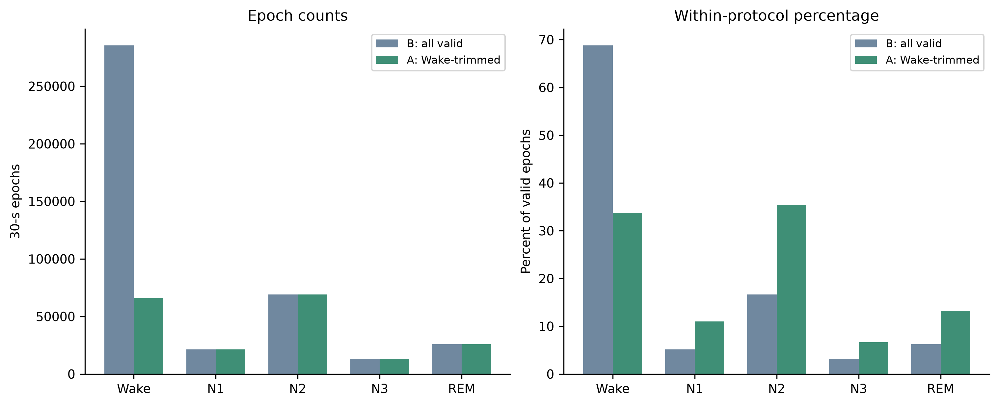
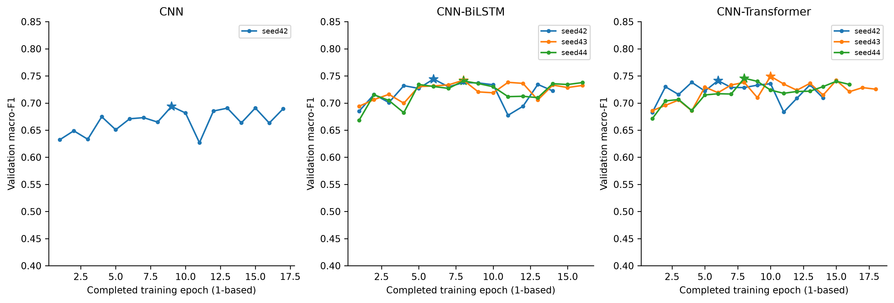
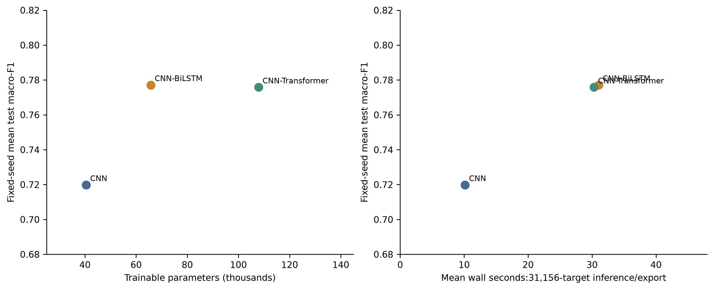
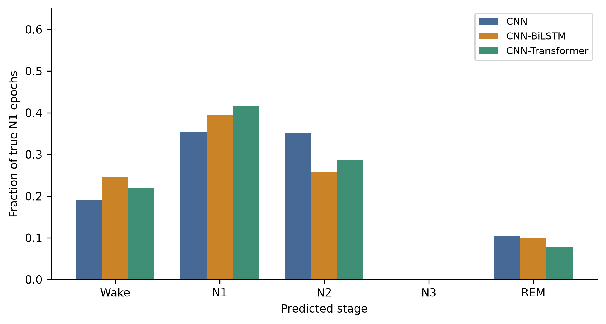

> Curated public-export copy. Historical originals remain unchanged. Links to excluded evidence point to the artifact-availability guide; this is not the complete private publication archive.

# Proposed supplementary material: structure, retained analyses and figure allocation

This is an editorial supplement proposal accompanying the [revised manuscript](publication_manuscript_revised.md). It includes retained explanatory text and original measurements, not a newly executed study. Main-text figures are reduced from sixteen to six; all sixteen saved PNG/PDF pairs remain unchanged. The allocation is proposed until a journal is selected. Internal filenames retain their historical numbering; the revised main and supplementary caption numbers determine presentation order.

## Main-manuscript essentials

| Revised figure | Saved artifact | Purpose |
| --- | --- | --- |
| 1 | [01_architectures](../results/publication_figures/01_architectures.pdf) | Make different context/capacity explicit |
| 2 | [04_primary_comparison](../results/publication_figures/04_primary_comparison.pdf) | Distinguish subject uncertainty and seed dispersion |
| 3 | [07_paired_intervals](../results/publication_figures/07_paired_intervals.pdf) | Show the three registered aggregate contrasts |
| 4 | [16_transition_errors](../results/publication_figures/16_transition_errors.pdf) | Keep the unfavorable transition outcome prominent |
| 5 | [06_classwise](../results/publication_figures/06_classwise.pdf) | Show minority-class precision, recall and F1 |
| 6 | [05_confusion_matrices](../results/publication_figures/05_confusion_matrices.pdf) | Show fixed seed-42 error structure; full-page placement |

Keep main Tables 1–4 for allocation, information/capacity/seeds, primary outcomes and transition/stable outcomes. If a journal allows fewer main figures, the illustrative confusion matrices are the first candidate for supplementary relocation; retain the transition figure in the main paper. Do not merge or redraw plots before choosing final journal dimensions. Figure 3's dark/pale interval meaning must remain in its caption because the saved image has no in-panel interval legend.

## Supplement S1. Dataset and preprocessing audit

Use Phase 1 inspection (additional evidence). [Availability and reproduction inputs](../docs/ARTIFACT_AVAILABILITY.md), Phase 2 preprocessing (additional evidence). [Availability and reproduction inputs](../docs/ARTIFACT_AVAILABILITY.md), inventory (additional evidence). [Availability and reproduction inputs](../docs/ARTIFACT_AVAILABILITY.md), [stage counts](../results/publication_tables/02_stage_distribution.md), saved response (additional evidence). [Availability and reproduction inputs](../docs/ARTIFACT_AVAILABILITY.md) and normalization (additional evidence). [Availability and reproduction inputs](../docs/ARTIFACT_AVAILABILITY.md) as authoritative technical attachments. If an archive is prepared, distribute a curated read-only copy under the applicable data terms, not raw EDFs by assumption.

Retain SC/ST separation; official filename pairing; common origin and exact half-open epochs; movement/unknown exclusions distinct from coverage and overhang; nonfinite/constant rejection; retained rail/edge flags; original epoch indexing; and the label-informed Wake eligibility definition. The archived report records SOS coefficients, padding, response, acquisition-filter limitations, split hashes and normalization precision. The main text displays a rounded mean/std; implementations must use saved full precision. No per-epoch filtering or per-subject/test-fitted normalization was substituted.

Figures S1–S2 give eligibility distributions and the historical training-only EEG/PSD/filter illustration. The top raster of S2 cannot be made vector or recover detail merely by a high-dpi container or PDF export. Preserve native resolution and avoid upscaling claims.

## Supplement S2. Complete outcomes, supports and uncertainty conventions

Proposed Tables S1–S6 map to the unchanged nine-checkpoint identity table (additional evidence). [Availability and reproduction inputs](../docs/ARTIFACT_AVAILABILITY.md), [all-seed test outcomes](../results/publication_tables/10_all_seed_test_metrics.md), [primary class precision/recall/F1](../results/publication_tables/04a_classwise_display.md), [all class metrics](../results/publication_tables/13_all_classwise_metrics.md), [paired contrasts](../results/publication_tables/05_paired_comparisons.md) and subject/recording metrics (additional evidence). [Availability and reproduction inputs](../docs/ARTIFACT_AVAILABILITY.md). Attach the recording table (additional evidence). [Availability and reproduction inputs](../docs/ARTIFACT_AVAILABILITY.md) alongside the last table. Machine-readable CSV counterparts retain full precision.

The primary outcome pools epochs within each seed before computing five-class macro-F1 and then averages fixed-seed metrics. Subject plots average seed-specific subject scores and are not the primary estimator. Bootstrap intervals resample subjects, not individual epochs; replicate counts and undefined-value handling remain in the registered analysis (additional evidence). [Availability and reproduction inputs](../docs/ARTIFACT_AVAILABILITY.md). Seed sample SD is distinct from subject uncertainty. Do not replace M1's undefined one-seed SD with zero, pool seeds into a fictitious ensemble, or promote an individual seed from its test score.

For completeness, accuracy equals single-label multiclass micro-F1; weighted F1 uses true-class supports. Balanced accuracy averages recall of present true classes. Cohen's kappa uses empirical true/predicted marginals. Specificity is TN/(TN+FP). Undefined P/R/F1 is zero, including absent classes in the five-class macro denominator; undefined specificity, kappa, AUC or AP is null. Saved one-vs-rest ROC/PR metrics, multiclass Brier score (mean sum of five squared probability errors) and ECE (ten equal-width confidence bins, final bin including one) are retained. No calibration transform or threshold was fitted to test labels.

Figures S5–S7 retain true-N1 prediction distributions, all subjects in identifier order and the deterministic first-recording hypnogram. Quality results remain in the unchanged quality table (additional evidence). [Availability and reproduction inputs](../docs/ARTIFACT_AVAILABILITY.md). All 328 flagged test epochs remain included; class-composition differences and the absence of expert artifact labels prevent an artifact-robustness conclusion. No new uncertainty calculation is introduced for descriptive subsets.

## Supplement S3. Secondary weighted-loss comparisons

M4's final macro-F1 was 0.7380 and N1 F1 0.4676, compared with M1's 0.7198 and 0.3823. The macro-F1 difference was 0.0182, with descriptive 95% interval [-0.0016, 0.0366]. Weighted M5 seed 42 achieved macro-F1 0.7855 and N1 F1 0.5204, compared with ordinary-CE M5 seed 42 values 0.7776 and 0.4726. Its macro-F1 difference interval was [-0.0036, 0.0200].

Both secondary aggregate intervals contain zero. N1 point estimates increase in these matched seed-42 references, but they do not justify promoting weighted loss to a new test-selected primary model. The comparisons have one seed per configuration, and stage-specific intervals are exploratory without an additional multiplicity guarantee. Validation and test directions also need not coincide; neither loss nor checkpoint was revised after observing these outcomes.

The saved descriptive N1 difference for M4 minus M1 is 0.0853 (95% interval [0.0387, 0.1178]); weighted minus ordinary M5 seed 42 is 0.0478 (95% interval [0.0022, 0.0934]). Neither is a new multiplicity-controlled primary claim. M4 accuracy 0.7965 and weighted M5 accuracy 0.8402 are retained on the same ratio scale as the source. The full [secondary comparison table](../results/publication_tables/05_paired_comparisons.md) preserves N3 and other outcomes.

## Supplement S4. Exploratory M8 and historical development

Validation learning curves are shown for every predefined primary seed. Different realized best epochs and stopping times are part of the saved evidence, rather than reasons to select an epoch using test scores.

Exploratory M8 combines multiscale convolution, center-query attention and gated central/context fusion. Its full-budget CE seed-42 validation macro-F1 was 0.7408. Fresh three-epoch control, no-multiscale and no-context runs scored 0.7174, 0.7045 and 0.6516. Removing components also changes parameter capacity and computation, and a short one-seed trajectory cannot establish converged module efficacy. There is no gate-only or parameter-matched control. The full-budget result is not an equal-budget substitute for the bounded control.

M8 remains exploratory and was never finally evaluated. Its familiar component combination does not establish architectural novelty. Proposed further validation campaigns were not executed here and must not now be used to iterate against the consumed test cohort. Reliable new model-development claims require new independent evaluation data and a separately registered design.

**Proposed Table S7. Original bounded M8 validation ablations.**

| M8 variant | Parameters | Completed epochs | Validation macro-F1 | Validation N1 F1 | Macro-F1 difference from bounded control |
| --- | --- | --- | --- | --- | --- |
| control | 44,629 | 3 | 0.717430 | 0.406780 | +0.000000 |
| no_multiscale | 31,861 | 3 | 0.704538 | 0.357660 | -0.012892 |
| no_context | 19,413 | 3 | 0.651634 | 0.244262 | -0.065796 |

Source: [saved validation CSV](../results/publication_tables/11_validation_metrics.csv) and original six-decimal report (additional evidence). [Availability and reproduction inputs](../docs/ARTIFACT_AVAILABILITY.md). Three completed training epochs per run, all full training/validation targets, fresh initialization, ordinary CE, seed 42. The table reproduces the original reported rounding; full precision remains in the source. These are not final-test results. The full-budget M8 CE run above is not interchangeable with the short bounded control. Component removal changes parameter count and computation; there is no capacity-matched, gate-only, converged multi-seed factorial comparison.

Retain the entire [validation development table](../results/publication_tables/11_validation_metrics.md) as proposed Table S8, including M6, weighted and conditional-repeat configurations. The optimizer pilot (additional evidence). [Availability and reproduction inputs](../docs/ARTIFACT_AVAILABILITY.md), Adam confirmation (additional evidence). [Availability and reproduction inputs](../docs/ARTIFACT_AVAILABILITY.md) and weighted-CNN validation report (additional evidence). [Availability and reproduction inputs](../docs/ARTIFACT_AVAILABILITY.md) are historical development attachments, not extra final comparators. Earlier reports' pending-test language reflects their execution dates, not the current completion state. No claim that an optional M3 or a deferred M8 confirmation was executed is introduced.

## Supplement S5. Implementation, convergence and cost

M1 has 40,501 parameters, M5 65,717 and M7 107,893. The analytic partial forward MAC counts per central target are approximately 4.638, 23.314 and 23.525 million. Contextual counts include re-encoding five epochs for every target, matching the implemented overlapping-window inference rather than an assumed embedding-cache optimization. Counts omit normalization, activations, pooling, softmax, bias additions and elementwise recurrent operations, so they are not complete FLOP estimates.

Mean measured training-attempt durations were 25.46, 63.93 and 68.53 minutes, while chunk inference/export over the entire test target set took 10.15, 31.04 and 30.32 mean wall seconds. Training times include the realized early-stopping trajectories and differ in epoch counts; inference/export includes data access, checkpoint loading and disk work within chunks. Neither provides a controlled kernel-latency or energy measurement. Differences across separate executions may reflect thermal state, caches and system load. Serialized checkpoints include optimizer/RNG/metadata and exceed the theoretical float32 parameter storage.

The parameter/cost table and plots describe a tradeoff rather than an efficiency optimum. CNN–BiLSTM uses fewer parameters than CNN–Transformer while producing a close fixed-seed mean macro-F1; the uncertainty does not establish that either architecture dominates on new populations.

Keep [full computational measurements](../results/publication_tables/06_computational_cost.md) as proposed Table S9 and Figure S4. Float32 parameter storage is in KiB (1,024 bytes), serialized checkpoint sizes in bytes, training in min and inference/export in s. MACs count selected operations per central target, not complete FLOPs, energy or peak accelerator memory. Saved timing completeness flags and differing early-stop trajectories remain attached.

Figure S3 retains every primary validation curve and validation-selected epoch. The original architecture protocol (additional evidence). [Availability and reproduction inputs](../docs/ARTIFACT_AVAILABILITY.md), baseline results (additional evidence). [Availability and reproduction inputs](../docs/ARTIFACT_AVAILABILITY.md), final configuration plan (additional evidence). [Availability and reproduction inputs](../docs/ARTIFACT_AVAILABILITY.md) and infrastructure report (additional evidence). [Availability and reproduction inputs](../docs/ARTIFACT_AVAILABILITY.md) supply exact software/hardware, model and checkpoint semantics. Every completed epoch commits optimizer/RNG/sampler/early-stop/history state with recoverable prior generations; incomplete epochs repeat. Source hashes and software versions support reproducibility, but bitwise MPS repeatability is not promised.

## Supplement S6. Representations and descriptive explanations

Saved 64-dimensional embeddings support PCA over all final targets and t-SNE over a uniformly sampled, seeded subset of 500 targets. The existing t-SNE analysis used seed 42, perplexity 30 and 500 iterations [R13]. These parameters were fixed before final reporting. Class, subject, recording, original epoch and checkpoint identities remain linked in the publication coordinate tables. Each model's projection has an independent coordinate system; visual distances cannot be compared as though axes were shared. Projected separation is descriptive, not evidence of causal features or a substitute for held-out classification metrics.

Representative saliency, compatible one-dimensional Grad-CAM and attention plots reuse previously saved validation examples bound to the same selected checkpoints. The N1 illustration is the first saved validation example of that true class, chosen without test outcomes. Gradients target the predicted logit, and attention corresponds to the saved final Transformer block. Their scales and architectural meaning differ across models. No new gradient extraction, model inference or retraining was performed to construct this publication package.

The references R7, R9 and R13 are defined in the [revised manuscript](publication_manuscript_revised.md). Figure S8 retains all saved PCA targets and the saved seeded t-SNE subset, without a new fit. The linked representation lineage (additional evidence). [Availability and reproduction inputs](../docs/ARTIFACT_AVAILABILITY.md) retains source coordinates and IDs. Scatter layers may be rasterized inside PDF. Keep the model-independent projection axes warning; separation does not establish a better physiological representation.

Figures S9–S10 reuse the saved validation N1 example SC4061E:e000935. Heatmap slots 0–4 in S9 are relative offsets −2 through +2, with slot 2 central; S10 uses relative offsets directly. Absolute saliency scales differ by model. S10 lacks a quantitative attention colorbar in its saved export; the present caption limits interpretation to qualitative within-example patterns. If later journal typesetting needs a calibrated colorbar, this would require a separately versioned presentation export from the saved tensor, not new model inference. No such export is performed here.

## Supplement S7. Reproducibility attachments

Include the frozen plan/checkpoint table, [original numerical ledger](../results/publication_tables/manuscript_numbers.json), original verification (additional evidence). [Availability and reproduction inputs](../docs/ARTIFACT_AVAILABILITY.md), revision verification (additional evidence). [Availability and reproduction inputs](../docs/ARTIFACT_AVAILABILITY.md), [reference audit](revised_reference_audit.md) and [author checklist](reviewer_readiness_report.md). Stable public archive URLs, licenses and any redaction requirements remain author actions. The source-code/processed-array/model artifacts are unchanged; no new experiment is proposed as a condition of this revision.

## Supplementary figure captions and existing exports

### Figure S1. 02_stage_distribution

All SC subjects combined for descriptive eligibility counts. Only external Wake is removed in A; no non-Wake class changes.

[PDF export](../results/publication_figures/02_stage_distribution.pdf). Source: results/stage_distribution_comparison.csv. Original manuscript figure: 1.

### Figure S2. 03_preprocessing

Figure withheld from this proposed source/evidence release: Figure S2. 03_preprocessing. [Availability and reproduction inputs](../docs/ARTIFACT_AVAILABILITY.md)

Top: unchanged saved training-only raster illustration of raw/continuous-filtered EEG and PSD, embedded at native raster resolution; no new EDF read or preprocessing. Bottom: analytic squared-amplitude response from saved SOS coefficients. The training example is illustrative, not an estimate of artifact prevalence.

PDF export (additional evidence). [Availability and reproduction inputs](../docs/ARTIFACT_AVAILABILITY.md). Source: results/phase2_figures/SC4001E_eeg_psd.png; results/filter_response.json. Original manuscript figure: 2.

### Figure S3. 08_training_convergence

Validation-only curves for every predefined primary checkpoint seed. Stars indicate best-validation epochs, never test-selected epochs.

[PDF export](../results/publication_figures/08_training_convergence.pdf). Source: Immutable checkpoint-derived saved export histories. Original manuscript figure: 13.

### Figure S4. 09_parameter_cost

Compactness versus measured task performance. Timing includes chunk loading/export on one Mac and is not a controlled latency or energy-efficiency comparison.

[PDF export](../results/publication_figures/09_parameter_cost.pdf). Source: results/phase5_model_comparison.csv; analytic model counts. Original manuscript figure: 12.

### Figure S5. 10_N1_errors

Distribution of predictions conditional on true N1, averaged over fixed seeds. The N1 column is recall; other columns are error fractions.

[PDF export](../results/publication_figures/10_N1_errors.pdf). Source: Saved final predictions, true N1 support3111 per seed. Original manuscript figure: 8.

### Figure S6. 15_subjectwise

Figure withheld from this proposed source/evidence release: Figure S6. 15_subjectwise. [Availability and reproduction inputs](../docs/ARTIFACT_AVAILABILITY.md)

All12 test subjects in identifier order, not ranked by outcome. Subject-level F1 retains all five classes; omitted true classes receive zero F1 by the registered convention.

PDF export (additional evidence). [Availability and reproduction inputs](../docs/ARTIFACT_AVAILABILITY.md). Source: results/phase5_subject_metrics.csv. Original manuscript figure: 9.

### Figure S7. 11_hypnograms

Figure withheld from this proposed source/evidence release: Figure S7. 11_hypnograms. [Availability and reproduction inputs](../docs/ARTIFACT_AVAILABILITY.md)

Lexicographically first test recording, not chosen for favorable performance. Original time and gaps retained; all three illustrative checkpoints use seed42. The displayed recording is SC4081E.

PDF export (additional evidence). [Availability and reproduction inputs](../docs/ARTIFACT_AVAILABILITY.md). Source: Saved final export metadata and predictions. Original manuscript figure: 11.

### Figure S8. 12_embeddings

Figure withheld from this proposed source/evidence release: Figure S8. 12_embeddings. [Availability and reproduction inputs](../docs/ARTIFACT_AVAILABILITY.md)

Saved embeddings: PCA all31,156 targets, t-SNE uniform seeded500-target subset, seed42/perplexity30/500 iterations. Separate models have independent coordinate systems; visual separation is descriptive.

PDF export (additional evidence). [Availability and reproduction inputs](../docs/ARTIFACT_AVAILABILITY.md). Source: Original saved PCA/t-SNE coordinates and parameter files. Original manuscript figure: 14.

### Figure S9. 13_explanations

Figure withheld from this proposed source/evidence release: Figure S9. 13_explanations. [Availability and reproduction inputs](../docs/ARTIFACT_AVAILABILITY.md)

Previously saved first validation example of true N1 from each seed42 checkpoint; predicted-logit saliency and compatible1D Grad-CAM. Selected without test outcomes. Scales are model dependent; not causal physiology. Exact IDs/checkpoint hashes remain in source manifests. Context heatmap slots 0–4 correspond to relative original-epoch offsets −2, −1, 0, +1, +2; slot 2 is central.

PDF export (additional evidence). [Availability and reproduction inputs](../docs/ARTIFACT_AVAILABILITY.md). Source: Checkpoint-linked original validation explanations.npz. Original manuscript figure: 15.

### Figure S10. 14_attention

Figure withheld from this proposed source/evidence release: Figure S10. 14_attention. [Availability and reproduction inputs](../docs/ARTIFACT_AVAILABILITY.md)

M7 seed42 last-block attention for the same saved validation N1 example. Four heads, masked keys; attention is descriptive and not a causal explanation. The existing image has no quantitative colorbar; interpret color patterns qualitatively, not as calibrated cross-head magnitudes.

PDF export (additional evidence). [Availability and reproduction inputs](../docs/ARTIFACT_AVAILABILITY.md). Source: Saved validation explanations.npz attention tensor. Original manuscript figure: 16.

